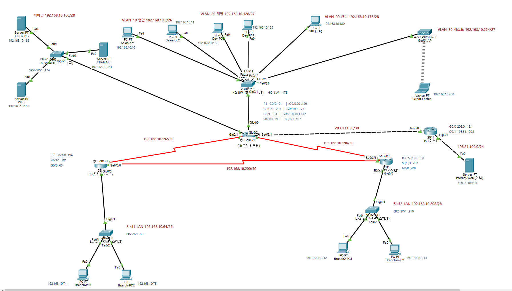
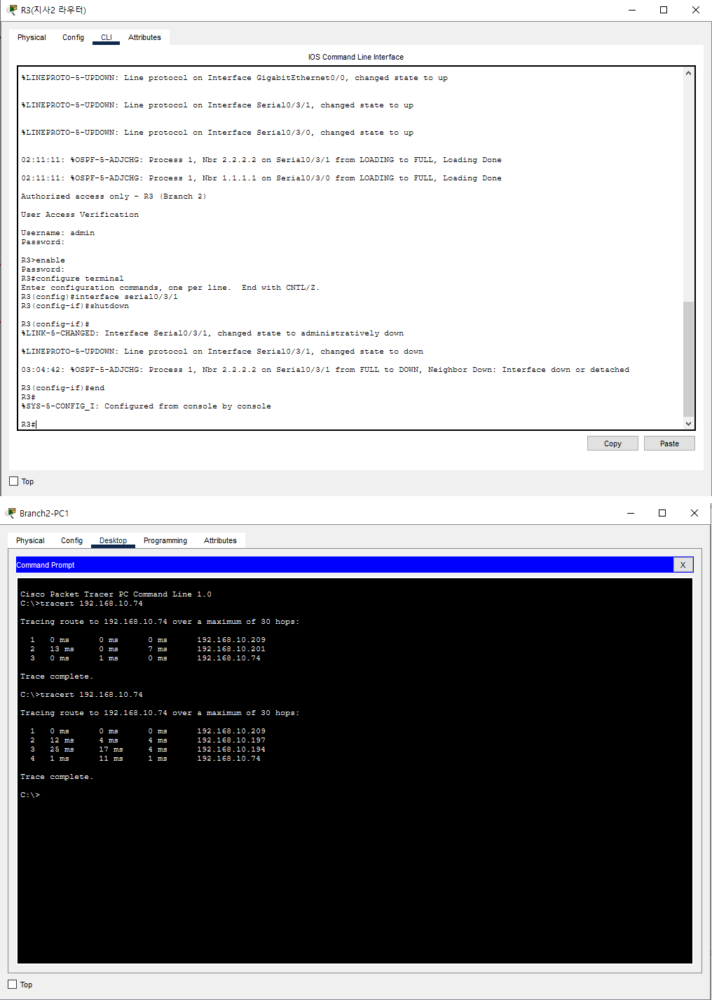

# 본사-지사 기업 네트워크 구축 (Cisco Packet Tracer)

네트워크관리사 2급을 공부하면서 VLAN, OSPF, NAT, ACL을 개념으로는 알았지만, 이것들을 한 네트워크 안에서 같이 동작시켜 본 적은 없었습니다. CCNA는 아직 없어서, 그 범위의 기술을 직접 설계하고 하나씩 확인한 결과물을 남기려고 이 프로젝트를 만들었습니다.

- 기간: 2026년 10월 27일 ~ 11월 3일
- 도구: Cisco Packet Tracer 8.x
- 장비: 라우터 2911 4대, 스위치 2960 4대, 무선 AP 1대, 서버 4대, PC 9대, 노트북 1대

## 무엇을 만들었나

직원 100명 정도의 회사를 가정했습니다. 본사에는 영업·개발·관리 부서와 방문객용 무선랜이 있고, 지사 두 곳이 전용선(시리얼 WAN)으로 본사와 연결됩니다. 웹, 메일, 파일 서버는 본사 서버팜에 모았고, 인터넷은 본사 라우터 한 곳으로 나갑니다.

사용한 기술: VLAN·트렁크, Router-on-a-stick, VLSM, OSPF, NAT/PAT, DHCP Relay, DNS·웹·FTP·메일 서버, 확장 ACL, SSH, Port Security, WPA2 무선랜

## 설계하면서 고민한 것

### 지사끼리도 직접 연결했습니다

처음에는 본사와 지사1만 연결했습니다. 지사2를 추가하면서 보니, 본사와 지사만 잇는 구조에서는 지사끼리 통신할 때 항상 본사를 거쳐야 하고, 본사-지사 선 하나가 끊기면 그 지사는 고립됩니다. 그래서 라우터 세 대를 삼각형으로 연결했습니다.

OSPF는 cost 합이 가장 작은 경로를 고릅니다. 평소에는 지사끼리 직통(cost 64)으로 가고, 직통 선을 끊으면 본사 경유(cost 128)로 바뀌는 것을 `tracert`로 확인했습니다(T20, T22).

### 방문객 무선랜은 사내망과 분리했습니다

방문객 노트북은 회사가 관리하지 않으니 사내 서버에 닿으면 안 됩니다. 게스트용 VLAN 30을 따로 만들고, 게이트웨이에 확장 ACL `GUEST_IN`을 걸어 인터넷만 나가게 했습니다.

사내 대역을 통째로 막으면 사내에 있는 DNS 서버까지 막혀서 인터넷 주소 이름도 찾을 수 없습니다. 그래서 DNS 허용 줄을 차단 줄보다 위에 두었습니다.

### 주소는 /24 하나로 해결했습니다

`192.168.10.0/24` 하나를 필요한 호스트 수에 맞춰 /26부터 /30까지 나눴습니다(VLSM). 처음 설계할 때 뒤쪽 대역을 비워 두었기 때문에, 나중에 무선랜과 지사2를 추가할 때 기존 주소를 하나도 바꾸지 않았습니다.

### 영업 부서는 FTP만 막았습니다

영업은 파일 서버(FTP)를 쓰면 안 되지만 메일은 써야 했습니다. 두 서비스가 같은 서버에 있어서 표준 ACL로는 둘 다 막힙니다. 포트 번호까지 보는 확장 ACL로 21번만 막았습니다.

주소 표, 장비별 설정 요약, 나머지 설계 이유는 [docs/design.md](docs/design.md)에 정리했습니다.

## 테스트

22개 항목을 직접 확인하고 화면을 남겼습니다. ID를 누르면 해당 화면이 열립니다.

| ID | 확인한 것 | 결과 |
|---|---|---|
| [T01](images/7-테스트_T01_DHCP-본사.png) | 본사 PC DHCP | 192.168.10.10/26 할당 |
| [T02](images/7-테스트_T02_DHCP-지사1.png) | 지사1 PC DHCP (Relay 경유) | 192.168.10.74/26 할당 |
| [T03](images/7-테스트_T03_VLAN간-통신.png) | 영업 ↔ 개발 VLAN 간 통신 | ping 응답 |
| [T04](images/7-테스트_T04_OSPF-이웃-R1.png) | R1 OSPF 이웃 | 2.2.2.2, 3.3.3.3 FULL |
| [T05](images/7-테스트_T05_라우팅테이블-R2.png) | 기본 경로 전파 | R2에 `O*E2 0.0.0.0/0` |
| [T06](images/7-테스트_T06_지사1-사내웹.png) | 지사 → 본사 웹 | `www.company.com` 접속 |
| [T07](images/7-테스트_T07_DNS-조회.png) | DNS 조회 | 192.168.10.163 응답 |
| [T08](images/7-테스트_T08_NAT-인터넷.png) | NAT로 인터넷 접속 | 203.0.113.2로 변환 |
| [T09](images/7-테스트_T09_FTP-허용-개발.png) | 개발 FTP 허용 | 로그인 성공 |
| [T10](images/7-테스트_T10_FTP-차단-영업.png) | 영업 FTP 차단 | Timed out, ACL deny 12 matches |
| [T11](images/7-테스트_T11_메일-송수신.png) | 영업 메일 허용 | 지사에서 수신 |
| [T12](images/7-테스트_T12_SSH-허용-관리.png) | 관리 VLAN SSH 허용 | `R1>` 접속 |
| [T13](images/7-테스트_T13_SSH-차단-영업.png) | 영업 SSH 차단 | Connection refused |
| [T14](images/7-테스트_T14_포트보안-MAC학습.png) | Port Security MAC 학습 | 5개 포트 Sticky 학습 |
| [T15](images/7-테스트_T15_포트보안-위반차단.png) | Port Security 위반 | 포트 Secure-shutdown |
| [T16](images/7-테스트_T16_무선-연결-DHCP.png) | 무선 연결 + DHCP | 192.168.10.230/27 할당 |
| [T17](images/7-테스트_T17_게스트-인터넷허용.png) | 게스트 인터넷 허용 | 외부 사이트 접속 |
| [T18](images/7-테스트_T18_게스트-사내망차단.png) | 게스트 사내망 차단 | Request Timeout, ACL deny 70 matches |
| [T19](images/7-테스트_T19_DHCP-지사2.png) | 지사2 PC DHCP | 192.168.10.212/28 할당 |
| [T20](images/7-테스트_T20_지사간-직통경로.png) | 지사 ↔ 지사 직통 | 본사를 거치지 않음 |
| [T21](images/7-테스트_T21_OSPF-이웃-R3.png) | R3 OSPF 이웃 | 1.1.1.1, 2.2.2.2 FULL |
| [T22](images/7-테스트_T22_WAN-장애우회.png) | WAN 한 구간 장애 | 본사 경유로 자동 우회 |

## 막혔던 부분

### FTP가 막혔는데, ACL 때문이 아니었습니다

영업 PC에서 FTP 접속이 실패해서 차단 테스트가 끝난 줄 알았습니다. 그런데 입력한 명령을 다시 보니 주소를 `ftp.compant.com`으로 잘못 쳤습니다. DNS에 없는 이름이라 실패한 것이고, ACL이 막았다는 증거는 아니었습니다.

주소를 고쳐 다시 하니 오류가 `Connect failed`에서 `Timed out`으로 바뀌었고, R1의 `show access-lists`에서 deny 줄 카운트가 올라간 것까지 보고 나서야 ACL이 막았다고 말할 수 있었습니다. 차단 테스트는 실패했다는 결과만으로는 부족하고 장비 쪽 기록까지 봐야 한다는 것을 알게 됐습니다.

### 준비한 설정과 실제 포트 이름이 달랐습니다

`Serial0/0/0` 기준으로 설정을 준비했는데, 시리얼 모듈을 꽂고 보니 장비에는 `Serial0/3/0`만 있었습니다. 모듈을 eHWIC 3 슬롯에 꽂았기 때문이었습니다. 포트 이름의 가운데 숫자가 슬롯 번호를 따른다는 것을 이때 알았습니다. R1, R2가 이미 같은 이름이라 모듈을 옮기지 않고 설정을 고쳤고, 나중에 추가한 R3도 같은 슬롯에 꽂아 이름을 맞췄습니다.

## 배운 점

- 설정을 넣는 것보다 제대로 됐는지 확인하는 데 시간이 더 걸렸습니다. 특히 차단 테스트는 실패 화면만으로는 부족했고, 장비의 카운트까지 봐야 했습니다.
- ACL은 줄 순서가 결과를 바꿉니다. 게스트 ACL에서 DNS 허용 줄을 차단 줄보다 위에 두지 않으면 인터넷도 이름으로는 쓸 수 없었습니다.
- 주소는 처음 설계할 때 여유를 둬야 합니다. 뒤쪽 대역을 비워 둔 덕분에 지사2와 무선랜을 넣을 수 있었지만, 지금은 4개(.204~.207)만 남았습니다.

## 한계와 다음에 할 것

- 본사 라우터와 스위치가 한 대씩이라 하나가 멈추면 본사 전체가 멈춥니다. 다음에는 L3 스위치 2대와 HSRP로 이중화해 보려고 합니다.
- 로그 수집(Syslog)과 시간 동기화(NTP)가 없습니다.
- 무선랜은 게스트용만 있습니다. 직원용이라면 개인 계정으로 인증하는 WPA2-Enterprise가 맞습니다.

## 파일

| 파일 | 내용 |
|---|---|
| [network.pkt](network.pkt) | Packet Tracer 파일 (8.x에서 열기) |
| [configs/](configs) | 장비 8대의 설정 |
| [docs/design.md](docs/design.md) | 주소 표, 설계 이유, 구축 과정 사진 |
| [docs/build-guide.md](docs/build-guide.md) | 단계별 구축 순서 |
| [docs/troubleshooting-scenarios.md](docs/troubleshooting-scenarios.md) | 다음에 해 볼 장애 실습 계획 |
| [docs/accounts.md](docs/accounts.md) | 실습용 계정 (실제로 쓰지 않는 비밀번호) |
