# 설계 상세

README에 다 넣기 어려운 주소 표, 설계 이유, 구축 중 찍은 화면을 모았습니다.

## 토폴로지

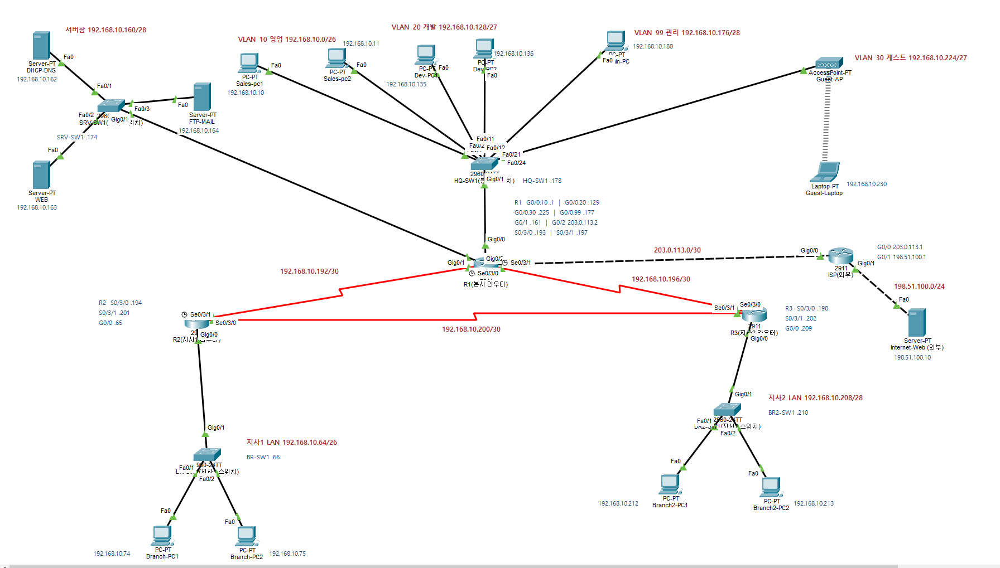

| 구간 | 연결 | 대역 |
|---|---|---|
| 인터넷 | R1 G0/2 ↔ ISP G0/0 | 203.0.113.0/30 |
| 본사 LAN | R1 G0/0 ↔ HQ-SW1 G0/1 (트렁크) | VLAN 10, 20, 30, 99 |
| 서버팜 | R1 G0/1 ↔ SRV-SW1 | 192.168.10.160/28 |
| 본사 ↔ 지사1 | R1 S0/3/0 ↔ R2 S0/3/0 | 192.168.10.192/30 |
| 본사 ↔ 지사2 | R1 S0/3/1 ↔ R3 S0/3/0 | 192.168.10.196/30 |
| 지사1 ↔ 지사2 | R2 S0/3/1 ↔ R3 S0/3/1 | 192.168.10.200/30 |

## IP 주소 (VLSM)

`192.168.10.0/24`를 필요한 호스트 수가 많은 구간부터 나눴습니다.

| 네트워크 | 필요 호스트 | 주소 | 서브넷 마스크 | 게이트웨이 | 사용 범위 |
|---|---|---|---|---|---|
| VLAN 10 영업 | 50 | 192.168.10.0/26 | 255.255.255.192 | 192.168.10.1 | .1 – .62 |
| 지사1 LAN | 50 | 192.168.10.64/26 | 255.255.255.192 | 192.168.10.65 | .65 – .126 |
| VLAN 20 개발 | 25 | 192.168.10.128/27 | 255.255.255.224 | 192.168.10.129 | .129 – .158 |
| 서버팜 | 10 | 192.168.10.160/28 | 255.255.255.240 | 192.168.10.161 | .161 – .174 |
| VLAN 99 관리 | 10 | 192.168.10.176/28 | 255.255.255.240 | 192.168.10.177 | .177 – .190 |
| R1–R2 WAN | 2 | 192.168.10.192/30 | 255.255.255.252 | - | .193 – .194 |
| R1–R3 WAN | 2 | 192.168.10.196/30 | 255.255.255.252 | - | .197 – .198 |
| R2–R3 WAN | 2 | 192.168.10.200/30 | 255.255.255.252 | - | .201 – .202 |
| 지사2 LAN | 10 | 192.168.10.208/28 | 255.255.255.240 | 192.168.10.209 | .209 – .222 |
| VLAN 30 게스트 무선 | 20 | 192.168.10.224/27 | 255.255.255.224 | 192.168.10.225 | .225 – .254 |
| 남은 대역 | - | 192.168.10.204 – .207 | - | - | - |
| R1–ISP | 2 | 203.0.113.0/30 | 255.255.255.252 | - | .1 – .2 |
| 인터넷 서버망 | - | 198.51.100.0/24 | 255.255.255.0 | 198.51.100.1 | - |

게스트 무선, 지사2, R1–R3·R2–R3 WAN은 처음 설계 뒤에 추가했습니다. 비워 둔 .196 이후 대역에서 서브넷 경계에 맞춰 넣었고, 기존 주소는 바꾸지 않았습니다.

203.0.113.0/24와 198.51.100.0/24는 문서·실습용으로 정해진 대역이라 실제 인터넷 주소와 겹치지 않습니다.

### 장비별 주소

| 장비 | 인터페이스 | IP 주소 | 비고 |
|---|---|---|---|
| R1 | G0/0.10 | 192.168.10.1/26 | 영업 게이트웨이, ACL `SALES_IN` in |
| R1 | G0/0.20 | 192.168.10.129/27 | 개발 게이트웨이 |
| R1 | G0/0.30 | 192.168.10.225/27 | 게스트 게이트웨이, ACL `GUEST_IN` in |
| R1 | G0/0.99 | 192.168.10.177/28 | 관리 게이트웨이 |
| R1 | G0/1 | 192.168.10.161/28 | 서버팜 게이트웨이 |
| R1 | S0/3/0 | 192.168.10.193/30 | 지사1 WAN (DCE) |
| R1 | S0/3/1 | 192.168.10.197/30 | 지사2 WAN (DCE) |
| R1 | G0/2 | 203.0.113.2/30 | 인터넷, NAT outside |
| R2 | G0/0 | 192.168.10.65/26 | 지사1 게이트웨이 |
| R2 | S0/3/0 | 192.168.10.194/30 | 본사 WAN |
| R2 | S0/3/1 | 192.168.10.201/30 | 지사2 WAN (DCE) |
| R3 | G0/0 | 192.168.10.209/28 | 지사2 게이트웨이 |
| R3 | S0/3/0 | 192.168.10.198/30 | 본사 WAN |
| R3 | S0/3/1 | 192.168.10.202/30 | 지사1 WAN |
| ISP | G0/0 / G0/1 | 203.0.113.1/30 / 198.51.100.1/24 | |
| HQ-SW1 | VLAN 99 | 192.168.10.178/28 | 관리 IP |
| SRV-SW1 | VLAN 1 | 192.168.10.174/28 | 관리 IP |
| BR-SW1 | VLAN 1 | 192.168.10.66/26 | 관리 IP |
| BR2-SW1 | VLAN 1 | 192.168.10.210/28 | 관리 IP |
| DHCP-DNS | Fa0 | 192.168.10.162/28 | DHCP, DNS |
| WEB | Fa0 | 192.168.10.163/28 | HTTP, HTTPS |
| FTP-MAIL | Fa0 | 192.168.10.164/28 | FTP, SMTP, POP3 |
| Internet-Web | Fa0 | 198.51.100.10/24 | 외부 웹사이트 |
| Guest-AP | Port 0 | 없음 (L2) | HQ-SW1 Fa0/24, VLAN 30 |
| PC, 노트북 | Fa0 / Wireless0 | DHCP | 범위는 [build-guide.md](build-guide.md) 8단계 |

### HQ-SW1 포트

| VLAN | 이름 | 포트 | 연결 장비 |
|---|---|---|---|
| 10 | SALES | Fa0/1 – 10 | Sales-PC1 (Fa0/1), Sales-PC2 (Fa0/2) |
| 20 | DEV | Fa0/11 – 20 | Dev-PC1 (Fa0/11), Dev-PC2 (Fa0/12) |
| 30 | GUEST | Fa0/24 | Guest-AP |
| 99 | MGMT | Fa0/21 – 22 | Admin-PC (Fa0/21) |
| 트렁크 | 10, 20, 30, 99 | G0/1 | R1 G0/0 |
| 미사용 | - | Fa0/23, G0/2 | shutdown |

### 도메인

| 이름 | 주소 | 용도 |
|---|---|---|
| www.company.com | 192.168.10.163 | 사내 웹 |
| ftp.company.com | 192.168.10.164 | 파일 서버 |
| mail.company.com | 192.168.10.164 | 메일 서버 |
| www.external.com | 198.51.100.10 | 외부 사이트 (NAT 테스트) |

## 설계 이유

### VLAN

부서를 VLAN으로 나누면 서브넷이 달라져서, 라우터에서 부서 단위로 ACL을 걸 수 있습니다. 브로드캐스트도 부서 안에서만 돕니다. 장비 관리용 VLAN 99는 일반 사용자와 섞이지 않게 따로 두었습니다.

### Router-on-a-stick

L3 스위치 없이 라우터 포트 하나로 VLAN 간 라우팅을 했습니다. 모든 VLAN 간 트래픽이 트렁크 하나를 지나가는 단점이 있지만 100명 정도면 괜찮다고 봤습니다. 사용자가 늘면 L3 스위치로 바꿀 부분입니다.

### OSPF

정적 경로로 하면 라우터 세 대에 서로의 네트워크를 전부 손으로 넣어야 하고, 선이 끊겼을 때 다른 길로 돌아가는 것도 직접 만들어야 합니다. OSPF는 이웃끼리 경로를 주고받고, 링크가 끊기면 알아서 다시 계산합니다.

삼각형 구성에서 시리얼 링크 cost는 모두 64입니다. 지사1↔지사2는 직통(64)이 본사 경유(128)보다 작아 직통으로 가고, 직통을 끊으면 본사 경유로 바뀝니다. R2의 라우팅 테이블에서는 R1–R3 구간(.196/30)으로 가는 길이 두 개(cost 128로 같음)라 둘 다 올라와 있는 것도 볼 수 있었습니다.

### 기본 경로와 NAT

R1에 `ip route 0.0.0.0 0.0.0.0 203.0.113.1`을 넣고 `default-information originate`로 OSPF에 실어 보냈습니다. 그래서 R2, R3에는 인터넷 관련 설정이 없습니다.

ISP 라우터는 192.168.10.0 대역으로 가는 길을 모릅니다. NAT가 없으면 요청은 나가도 응답이 돌아오지 못합니다. PAT(overload)로 내부 전체가 공인 IP 하나(203.0.113.2)를 포트 번호로 나눠 씁니다.

### DHCP Relay

DHCP 서버는 서버팜에 한 대만 두었습니다. PC가 보내는 DHCP 요청은 브로드캐스트라 라우터를 넘지 못하기 때문에, 각 게이트웨이에 `ip helper-address 192.168.10.162`를 넣어 서버로 전달했습니다. 서버는 요청이 들어온 게이트웨이 주소를 보고 맞는 풀에서 주소를 줍니다.

### 영업 FTP 차단 (SALES_IN)

- FTP와 메일이 같은 서버(.164)에 있어서, 포트까지 볼 수 있는 확장 ACL로 21번만 막음
- 확장 ACL은 출발지 가까이에 두는 것이 원칙이라 영업 게이트웨이 G0/0.10에 in 방향으로 적용
- 마지막 `permit ip any any`가 없으면 암묵적 deny 때문에 영업 VLAN 통신이 전부 막힘

### SSH와 VTY 제한

Telnet은 비밀번호가 그대로 보이기 때문에 SSH v2만 허용했습니다. `access-class 99`로 관리 VLAN(192.168.10.176/28)에서 오는 접속만 받고, 영업 PC에서 시도하면 비밀번호를 묻기 전에 거부되는 것을 확인했습니다(T13).

### Port Security

허락하지 않은 기기를 사무실 포트에 꽂는 것을 막으려고 넣었습니다. `sticky`로 처음 연결된 MAC을 기억하고, PC 뒤에 IP 전화기를 다는 경우를 생각해 최대 2개로 했습니다. 위반하면 포트가 꺼집니다. AP 포트는 뒤에 무선 기기가 여러 대 붙기 때문에 제외했습니다.

### 게스트 무선 (GUEST_IN)

게스트 VLAN 30의 게이트웨이에 in 방향으로 걸었습니다. ACL은 위에서부터 처음 맞는 줄만 적용되기 때문에 순서를 이렇게 정했습니다.

1. DHCP(67) 허용 – 없으면 주소를 못 받음
2. DNS 서버(.162)로 가는 53번 허용 – 사내 대역 차단보다 위에 있어야 함
3. 게이트웨이 ping 허용 – 연결 확인용
4. 사내 대역 192.168.10.0/24 차단
5. 나머지(인터넷) 허용

게스트에게 개인 계정을 줄 수는 없어서 공용 비밀번호(WPA2-PSK)를 썼습니다. 직원용 무선을 만든다면 WPA2-Enterprise(802.1X)가 맞다고 생각합니다. AP가 한 대라 컨트롤러(WLC) 없이 단독형으로 설정했습니다.

## 설정 요약

| 기술 | 장비 | 핵심 설정 |
|---|---|---|
| VLAN, 트렁크 | HQ-SW1 | `vlan 10/20/30/99`, `switchport trunk allowed vlan 10,20,30,99` |
| VLAN 간 라우팅 | R1 | `interface g0/0.10` + `encapsulation dot1Q 10` |
| OSPF | R1, R2, R3 | `router ospf 1`, `network ... area 0`, `passive-interface` |
| 기본 경로 | R1 | `ip route 0.0.0.0 0.0.0.0 203.0.113.1`, `default-information originate` |
| NAT/PAT | R1 | `ip nat inside source list 1 interface g0/2 overload` |
| DHCP Relay | R1, R2, R3 | `ip helper-address 192.168.10.162` |
| 확장 ACL | R1 | `SALES_IN`, `GUEST_IN` |
| 무선 | Guest-AP, Guest-Laptop | SSID `Company-Guest`, WPA2-PSK, AES |
| SSH | 라우터 3대, 스위치 4대 | `crypto key generate rsa`, `ip ssh version 2`, `transport input ssh` |
| VTY 제한 | 라우터 3대, 스위치 4대 | `access-list 99`, `access-class 99 in` |
| Port Security | HQ-SW1 | `maximum 2`, `mac-address sticky`, `violation shutdown` |

전체 설정은 [configs](../configs), 구축 순서는 [build-guide.md](build-guide.md)에 있습니다.

## 구축 중 찍은 화면

R1에 시리얼 모듈 HWIC-2T 장착. 2911에는 기본 시리얼 포트가 없습니다.

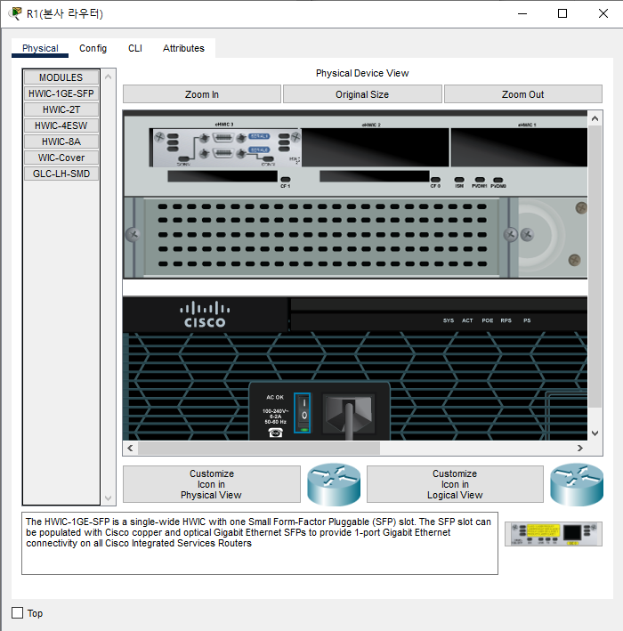
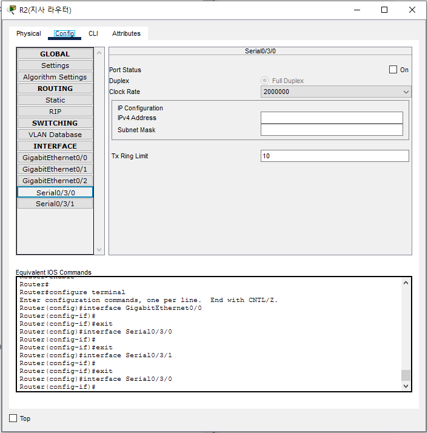

게스트 노트북 랜카드를 무선(WPC300N)으로 교체

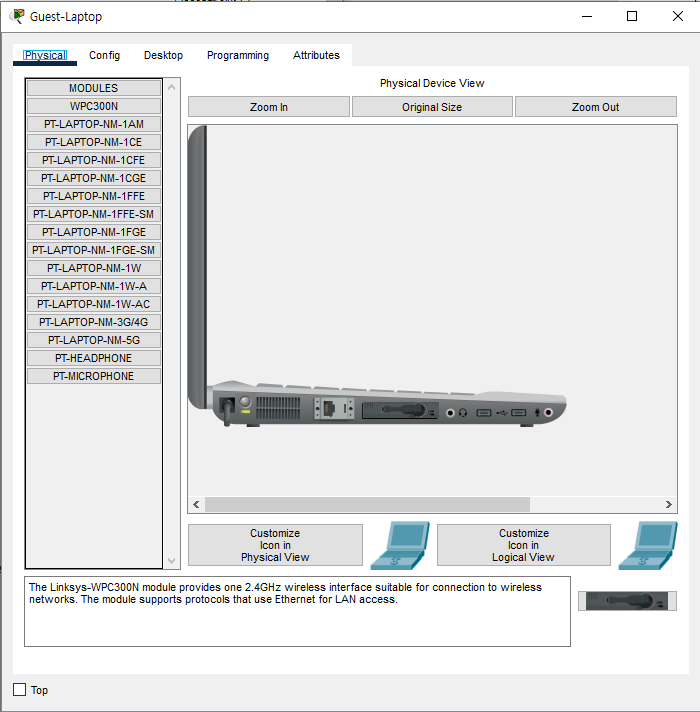

`show controllers`로 R1이 DCE인지 확인

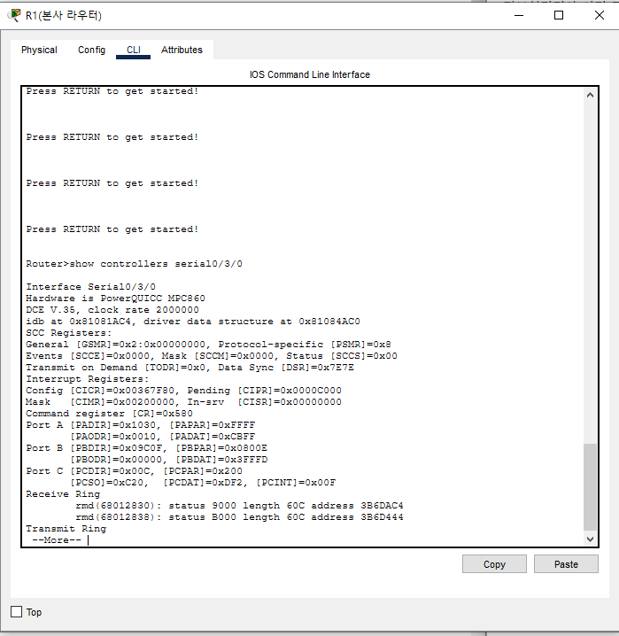

HQ-SW1 VLAN 확인

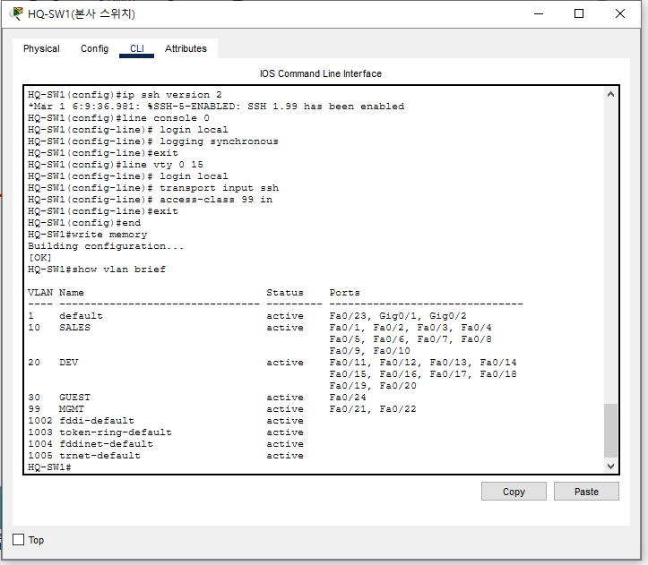

R1 서브인터페이스와 포트 상태

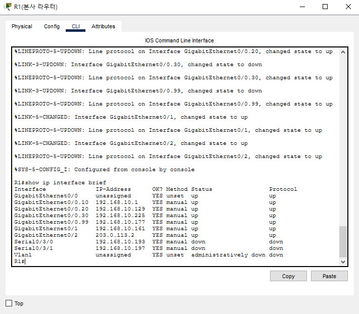

R3 설정 직후 R1, R2와 OSPF 이웃이 맺어지는 메시지

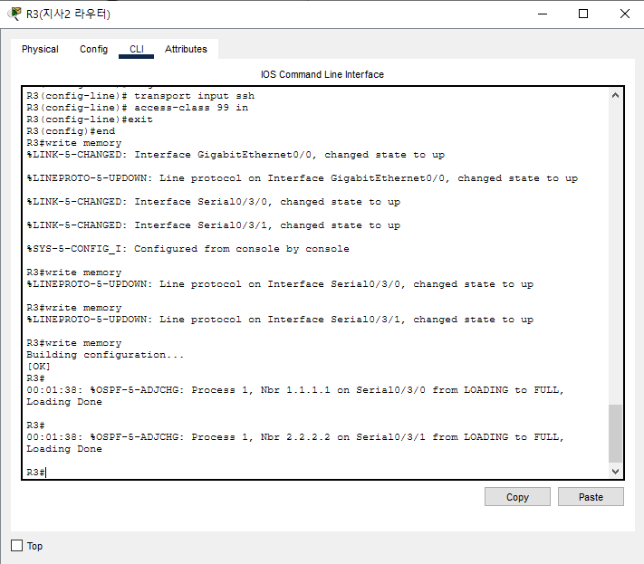

DHCP 풀 7개와 DNS 레코드

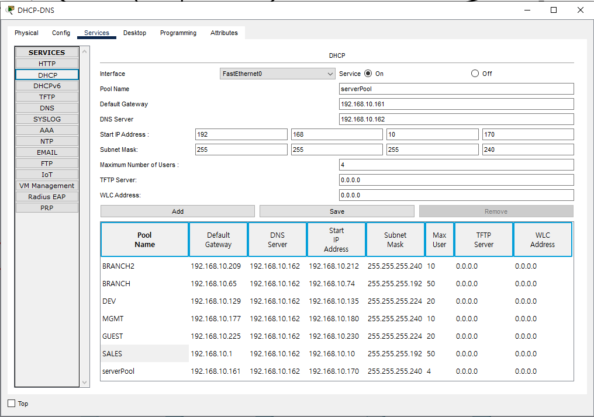
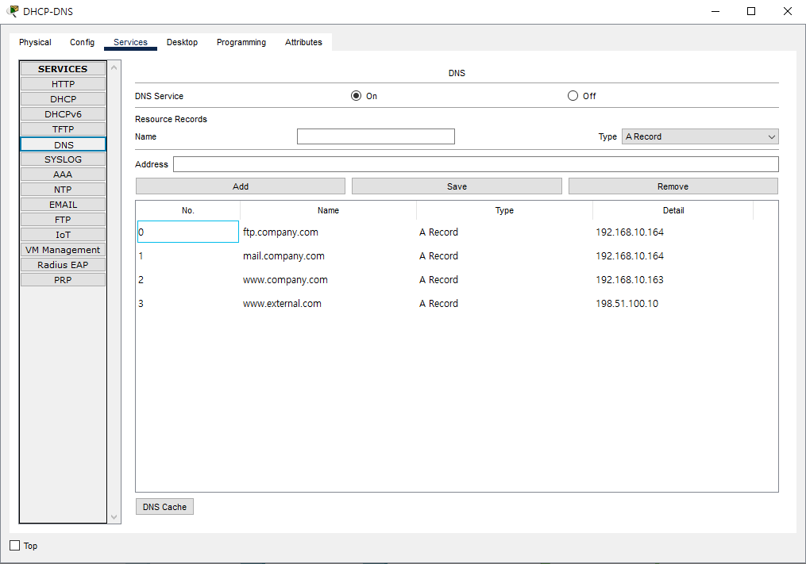

게스트 AP 무선 설정

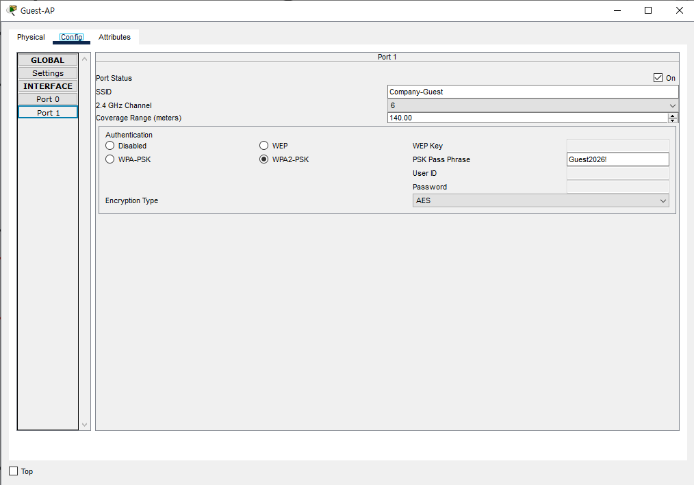
